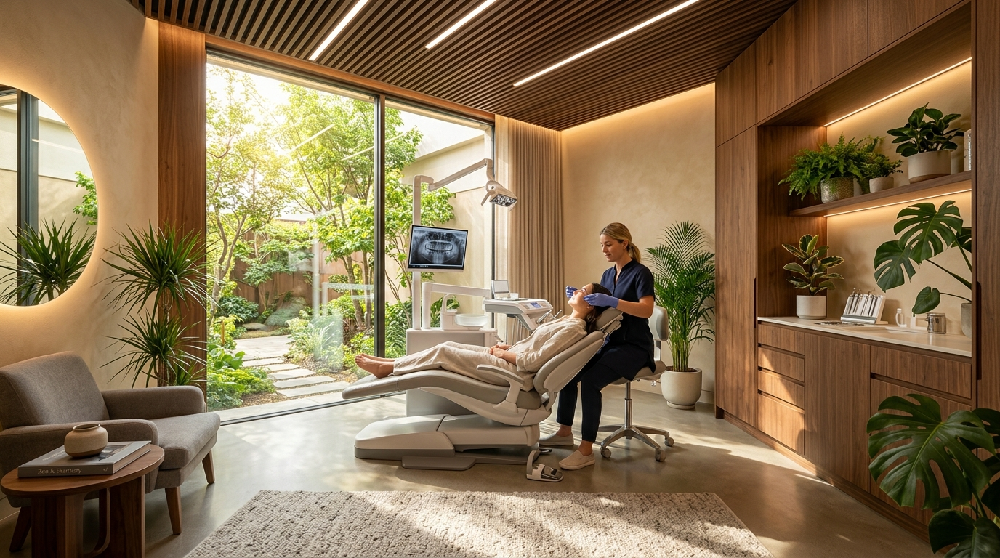

# 🦷 Aura Dental Studio - Modern Dentist Demo Webpage

An award-winning, responsive, and animated demo website crafted specifically for **dentists, cosmetic dental studios, and implant centers**. Built with pure **HTML5, CSS3, and Vanilla JavaScript** with zero external library dependencies.



---

## 🌟 Executive Summary & Pitch Highlights

This project was built for freelance presentations to dental clinic owners and healthcare clients. It addresses the **#1 psychological barrier in dentistry (dental anxiety & fear of pain)** by combining:
- **Aesthetic Medical Luxury:** Pristine cyan and medical blue gradients, deep navy authority, and glassmorphic card surfaces.
- **Painless Care Emphasis:** Prominent badges highlighting computer-aided Wand® anesthesia, biological lasers, and spa amenities.
- **Interactive Engagement Tools:** Real-time treatment cost estimator, interactive before/after case studies, filterable treatment tabs, and an instant appointment booking modal.

---

## 🚀 Key Features

### 1. Header & Navigation
- **Emergency Announcement Bar:** Top ribbon featuring live pulse indicator, same-day emergency triage notice, direct phone link, and clinic hours.
- **Sticky Glassmorphic Navbar:** Smooth frosted-glass blur on scroll, single-line horizontal alignment, active scrollspy link tracker, and quick call button.
- **Mobile Drawer Menu:** Fully responsive animated hamburger menu for tablets and mobile devices.

### 2. High-Converting Hero Section
- **Dynamic Floating Cards:** 
  - `Dr. Elena Vance, DDS` rating badge (5.0 ★ verified).
  - `100% Gentle & Painless` laser guarantee badge.
  - `Today's Openings: 2 Slots Remaining` live appointment callout.
- **Trust Metrics Ribbon:** 15,000+ smiles transformed, 99.8% painless index, and 4.9★ rating.
- **Insurance Acceptance Bar:** Logos/chips for Delta Dental, Cigna, MetLife, Aetna, and 0% APR CareCredit financing.

### 3. Interactive Treatments & Services Grid
- **Category Filter Tabs:** Instant client-side filtering by *All Treatments*, *Cosmetic Dentistry*, *Implants & Surgery*, *Clear Aligners*, and *Preventive & Family*.
- **Balanced Card Layout:** Standardized headers with category badges, feature checklists, transparent starting prices, and direct consultation booking triggers.

### 4. Smile Gallery (Real Transformations)
- **Interactive Case Switcher:** Toggle between real patient cases:
  - *Case 1:* Handcrafted Porcelain Veneers (2 Visits)
  - *Case 2:* Invisalign® Diamond Clear Aligners (7 Months)
  - *Case 3:* Same-Day Computer-Guided Implants (Single Day)
- **Visual Showcase:** High-resolution result image with floating porcelain shade tags and clinical metadata.

### 5. Interactive Treatment Cost & Duration Estimator
- **Live Pricing Engine:**
  - Select from Veneers, Implants, Clear Aligners, Laser Whitening, or Deep Cleaning.
  - Interactive tooth count range slider (1 to 10 teeth).
  - Sedation comfort selector (Gentle Wand, Nitrous Gas, Twilight Sleep).
  - Insurance toggle simulating ~20% PPO coverage savings.
  - Automatic calculation of **total cost**, **flexible monthly installments (0% APR)**, and **timeframe**.

### 6. Spa-Inspired Technology & Experience
- Detailed spotlight on needle-free Wand® anesthesia, Waterlase iPlus® biological laser, and sensory suite amenities (Bose noise-canceling headsets, Netflix VR glasses).

### 7. Board-Certified Doctor Profiles
- Dedicated specialist cards with credentials (Columbia, Harvard, Penn), specialties, and individual appointment booking buttons.

### 8. Patient Reviews & Verified Google Rating Wall
- 4.9/5.0 Google Reviews showcase with verified patient testimonials and star ratings.

### 9. Interactive Booking Modal & Confirmation Toast
- Pop-up appointment scheduling form with patient details, treatment selection, doctor selection, preferred date, and time-of-day pills (Morning, Afternoon, Evening).
- Instant confirmation toast notification that auto-dismisses after 7 seconds.

### 10. Complete Footer with 2026 Copyright
- Clinic directory, department links, operating hours table (Mon-Sun), newsletter subscription form, and the required copyright line:
  > **`2026 @ Aura Dental Studio. All rights reserved. • Licensed Medical Dental Facility.`**

---

## 📁 Directory Structure

```text
demo dentist webpage/
│
├── index.html              # Clean, semantic HTML5 structure with SEO metadata
├── style.css               # Modular CSS3 design system, animations & responsive media queries
├── script.js               # Vanilla JavaScript for interactive tabs, calculator, and modal
├── README.md               # Project documentation & client presentation guide
│
└── images/                 # Optimized high-resolution image assets
    ├── hero_dentist.jpg    # Modern female dentist portrait in clinic
    ├── clinic_lounge.jpg   # Ultra-modern spa-like dental treatment suite
    └── smile_showcase.jpg  # Radiant healthy smile transformation result
```

---

## 💻 How to Run Locally

### Option 1: Direct Browser Launch
Simply double-click `index.html` or drag it into any modern web browser (Google Chrome, Microsoft Edge, Safari, Mozilla Firefox).

### Option 2: Local HTTP Server (Recommended)
You can run a local server using Python or Node.js:

**Using Python:**
```bash
python -m http.server 8080
```
Then visit: `http://localhost:8080`

**Using Node.js:**
```bash
npx serve .
```

---

## 🎨 Design System & Customization

All styling variables are centralized at the top of [`style.css`](style.css) under `:root`:

```css
:root {
  --color-primary: #0284c7;        /* Medical Cyan / Blue */
  --color-primary-dark: #0369a1;
  --color-accent-teal: #0d9488;
  --color-accent-gold: #f59e0b;
  --color-dark: #09192f;          /* Deep Navy Blue */
  --font-heading: 'Outfit', sans-serif;
  --font-body: 'Plus Jakarta Sans', sans-serif;
}
```

### Quick Client Branding Steps:
1. **Clinic Name & Phone:** Search & replace `Aura Dental` and `(800) 555-DENT` in [`index.html`](index.html).
2. **Clinic Hours & Address:** Update the address in the top bar and footer column in [`index.html`](index.html).
3. **Doctors & Staff:** Replace names, universities, and photos inside the `#doctors` section.
4. **Treatment Pricing:** Update the `data-price` attributes on `<option>` tags in `#calcTreatment` inside [`index.html`](index.html).

---

## 📱 Responsiveness & Browser Support

- **Desktop & Widescreen (1200px+):** Full multi-column layout with floating micro-cards and sticky navigation.
- **Laptops & Tablets (768px - 1180px):** Symmetrical 2-column grids with adjusted spacing.
- **Mobile Screens (< 640px):** Single-column stacked cards, full-width touch targets, and slide-down navigation drawer.
- **Cross-Browser Compatible:** Chrome, Safari, Firefox, Edge, iOS Safari, and Android Chrome.

---

## 📄 License & Attribution

Crafted for freelance presentation and commercial dental practice demonstration.  
**© 2026 @ Aura Dental Studio.** All rights reserved.
